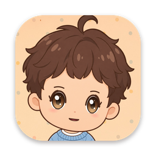
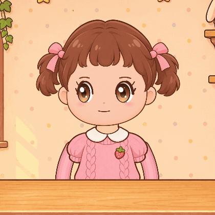
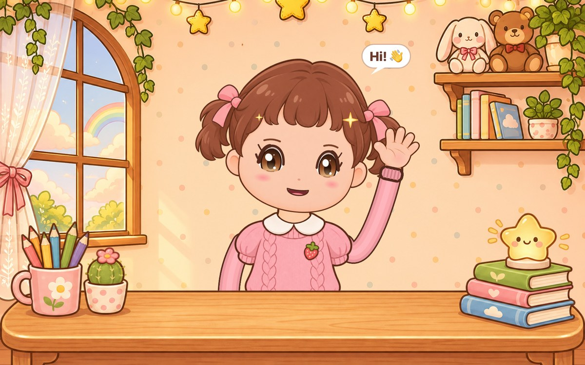
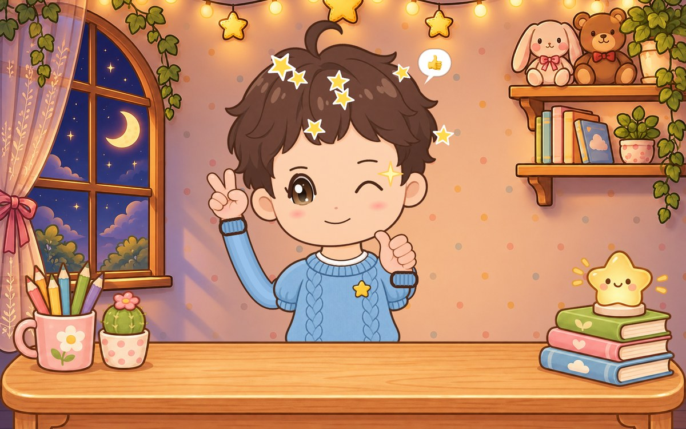
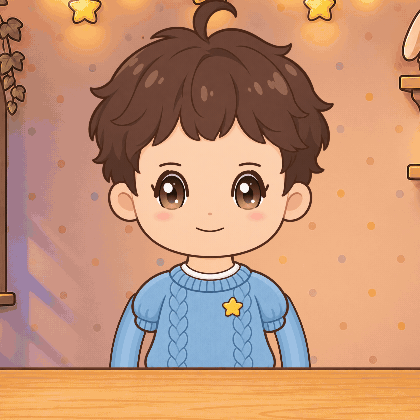
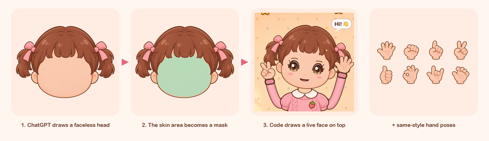
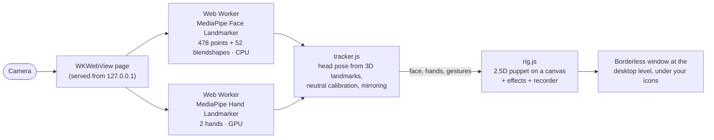

<p align="center">
  
</p>

<h1 align="center">MiniMe</h1>

<p align="center">
  <b>A tiny chibi <i>you</i> lives on your Mac wallpaper and copies your face, head and hands in real time.</b><br>
  Blink, wink, smile, pout, puff your cheeks, wave, throw a ✌️. MiniMe does it too.
</p>

<p align="center">
  <a href="https://github.com/hbadri-dev/minime/releases/latest"></a>
  
  
  
  <a href="LICENSE"></a>
  <a href="https://github.com/hbadri-dev/minime/actions/workflows/build.yml"></a>
</p>

<p align="center">
  
</p>

<p align="center">
  
  
</p>

---

## ✨ What it does

| | |
|---|---|
| 🙂 **Face** | 52 facial blendshapes: blinks and **one-eyed winks**, where you look, eyebrows (raised, frowning, worried), smile (even a lopsided one), open mouth, 😗 kiss, 🐡 puffed cheeks, frown |
| 🙆 **Head** | turn, nod, tilt, move around, and **lean toward the camera**: MiniMe comes closer too |
| 🙌 **Hands** | hand drawings in the same art style (open, fist, point, ✌️, 👍, 👌, 🤘) that follow your hand's position and angle, with arms that reach for them |
| 🎉 **Reactions** | wave → “Hi! 👋” · 👍 → stars · ✌️ → wink + sparkles · 🫶 heart hands → a burst of hearts · kiss → a heart floats out · surprise → “!” · angry → 💢 · wink → ✨ · big laugh → sparkles |
| 😴 **Sleep** | step away and MiniMe dozes off (Z z z). Come back and it wakes up with a little hop |
| 🌙 **Day & night** | the room follows the clock: sunny afternoon, or a moonlit night with glowing fairy lights |
| 🎬 **Share it** | one click records a 10-second **vertical 1080×1920 video, you on the bottom and MiniMe on top**, ready for Reels/TikTok/Shorts. Also: MiniMe-only video, or a photo |
| 🔒 **Private** | everything runs on your Mac. Nothing is uploaded, and the camera only runs while the wallpaper is visible |

<p align="center">
  
</p>

## 📦 Install

1. Download **`MiniMe-x.y.z.zip`** from the [latest release](https://github.com/hbadri-dev/minime/releases/latest), unzip it, and drag **MiniMe.app** into *Applications*.
2. MiniMe is open-source and not notarized by Apple, so the first launch needs one extra step:
   **right-click → Open**, or open it once, then go to **System Settings → Privacy & Security → Open Anyway**.
3. Allow camera access. MiniMe appears on your desktop, with a 🙂 in the menu bar.

> Requires macOS 13 Ventura or later. Apple silicon recommended. The app is a universal binary, but the Intel build hasn't been tested.

## 🎛 Menu bar

| Menu item | What it does |
|---|---|
| 🎬 Record 10 s for Reels/TikTok | 3-2-1 countdown, then records you + MiniMe and saves an MP4 to your Desktop |
| 🎬 Record 10 s (MiniMe only) | 1920×1080 video of just the wallpaper scene |
| 📸 Photo | a vertical still of you + MiniMe |
| 👧 Girl / 👦 Boy | switch characters |
| Day & night | automatic (by the clock), always day, or always night |
| 🎯 Calibrate | look straight at the screen and click: this becomes MiniMe's neutral pose |
| Mirror mode | on: MiniMe moves like your reflection. Off: like seen through a camera |
| Pause camera · Show camera & tracking points · Open at login | what they say |

The menu is in English, or in Persian when that's your Mac's language.

## 🧠 How it works

<p align="center"></p>

All the artwork was generated with ChatGPT image generation, then turned into a puppet:

- **Faceless heads.** ChatGPT drew each kid with a blank face. `tools/process_assets.py` flood-fills the skin to make a mask, so the eyes, brows and mouth (drawn live in code) sit under the bangs and inside the face.
- **2.5D head turns.** The head is warped strip by strip (`x' = x + d·R·(1−u²)`), so the face slides across the head as you turn or nod, while the outline stays put.
- **Chibi-aware hands.** Your hand position is measured in *face widths* from your face. Near the face MiniMe uses face scale (hand on cheek → hand on cheek). Lower down it switches to its tiny body's scale.



- **Native shell (Swift, no Xcode project).** A borderless `NSWindow` at the desktop window level shows a `WKWebView`. It turns the camera off when the wallpaper is covered, the screen is locked or the Mac sleeps, and runs the menu bar item.
- **Why a local server?** The page is served from a tiny `127.0.0.1` server so it counts as a secure context (needed for the camera and MediaPipe's WebAssembly). Its only write endpoint saves your recordings to the Desktop and needs a per-launch token.
- **Performance.** Face tracking runs at ~30 fps and hands at ~15 fps in two Web Workers, so drawing and recording stay smooth. The canvas only covers the area around the kid.

## 🛠 Build from source

```bash
git clone https://github.com/hbadri-dev/minime.git
cd minime
./build.sh --install     # downloads MediaPipe (pinned + checksummed), builds, installs to ~/Applications, launches
```

You only need the Xcode Command Line Tools (`xcode-select --install`). There's no Xcode project: `build.sh` calls `swiftc` directly and produces a universal, ad-hoc-signed `build/MiniMe.app`. `./build.sh --zip` also makes the release zip.

<details>
<summary><b>Development tips</b></summary>

- **Try the puppet in a browser:** `python3 -m http.server 8765 --directory web` → <http://localhost:8765/?demo>.
  Keys: <kbd>s</kbd> smile, <kbd>k</kbd> kiss, <kbd>p</kbd> puff, <kbd>o</kbd> surprise, <kbd>b</kbd> blink, <kbd>w</kbd> wave, <kbd>h</kbd> hearts, <kbd>t</kbd> thumbs up, <kbd>v</kbd> peace, <kbd>g</kbd> switch kid, <kbd>d</kbd> debug. Without `?demo`, it uses your webcam.
- **Edit the web files without rebuilding:** `defaults write com.minime.wallpaper webDir "$PWD/web"`, then use *Reload* in the menu.
- **Logs:** `~/Library/Caches/com.minime.wallpaper/web.log`
- **New art:** put images in `art/raw/` and run `python3 tools/process_assets.py`.

</details>

## 🗂 Project layout

```
Sources/
  main.swift            desktop-level window, web view, menu bar, camera on/off, recording window
  LocalServer.swift     127.0.0.1 file server + token-protected "save to Desktop"
  FaceTracker.swift     Apple Vision fallback, used only if MediaPipe can't load
  Strings.swift         English / Persian menu text
web/
  index.html            page shell
  tracker.js            camera → workers → face/hand parameters, calibration, gestures
  mp-worker.js          MediaPipe face or hand landmarker in a Web Worker
  rig.js                the puppet: face, warps, arms & hands, effects, day/night, recorder
  assets/               processed art (generated by tools/process_assets.py)
art/raw/                original ChatGPT images
tools/                  process_assets.py, fetch_mediapipe.sh
```

## 🤝 Contributing

Ideas and PRs are welcome: new characters, more hand poses, multi-monitor support, more reactions.
If you add a character, generate a **faceless** head, a matching **armless** body and keep the same art style.
The docstrings in `tools/process_assets.py` explain what it measures (face mask, shoulders, hand anchors).

## 📄 License

[MIT](LICENSE) © hojat. The artwork in this repo was generated with ChatGPT for this project and is released under the same license.
Face and hand tracking by [MediaPipe](https://github.com/google-ai-edge/mediapipe) (Apache-2.0), downloaded at build time. See [THIRD_PARTY_NOTICES.md](THIRD_PARTY_NOTICES.md).
